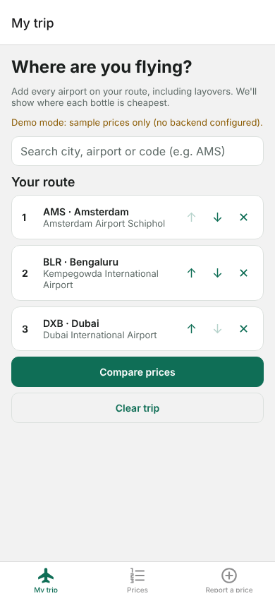
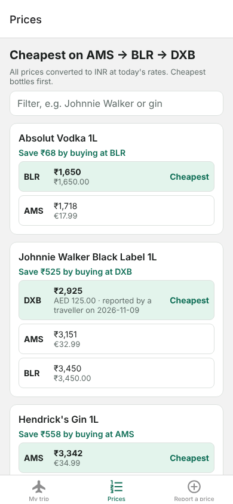
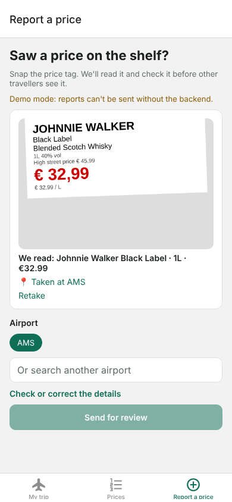

# Duty Free Guide

Find where each bottle is cheapest on your trip. Add the airports on your route (including layovers)
and see every liquor price at those airports' duty-free shops, converted to INR, cheapest first.

| My trip | Prices | Report a price |
|---|---|---|
|  |  |  |

## How it works
- **Prices** come from the airports' online shops (collected once a day) and from travellers who
  snap the shelf tag. The tag is read on the device (OCR), the photo's location is checked against
  the airport, and a reviewer approves it before it appears.
- **Currency**: everything is converted to INR with daily ECB rates (Frankfurter).
- **Stack**: Expo (React Native) for web/iOS/Android · Supabase (Postgres, Auth, Storage) · Python scrapers on GitHub Actions.

Design docs: [HLD](docs/hld.md) · [LLD](docs/lld.md) · [Decisions (ADRs)](docs/adr/) · [Problems log](docs/problems-log.md)

## Run the app (no backend needed)
```bash
cd client
npm install
npm run web          # or: npm run ios / npm run android
```
Without Supabase settings the app runs on built-in sample prices ("Demo mode").

**Phones:** shelf-tag OCR uses Google ML Kit, which isn't in Expo Go. Use a development build:
`npx expo run:android` / `npx expo run:ios` (or an EAS dev build). The web app needs nothing extra;
its OCR engine is copied into `client/public/ocr` on `npm install`.

## Install on an Android phone (no laptop needed)
Every push to `main` builds a standalone APK on GitHub Actions and publishes it to the
**[Android APK (latest)](../../releases/tag/android-latest)** release.
1. On the phone, open that release page and tap the `.apk` file.
2. Allow Chrome to install unknown apps when Android asks, then tap **Install**.
3. Updating: install the newer APK over the old one. Your trip is kept.

Pull requests build an APK too: open the PR's **Android APK** check → *Summary* → *Artifacts*
(it downloads as a .zip containing the .apk). The APK is signed with a debug key: fine for your own
phone, but the Play Store needs a proper signing key (see `docs/adr/0009-android-apk-builds.md`).

## Connect a real backend
The hosted project is `pkywwbvqpwomvbldgbyw` (its URL is in `.github/workflows/supabase-deploy.yml`).
1. In Supabase, Authentication → Sign In / Providers: enable **anonymous sign-ins** (used for price reports).
2. Add three [repository secrets](../../settings/secrets/actions):
   - `SUPABASE_ACCESS_TOKEN`: Account → Access Tokens
   - `SUPABASE_DB_PASSWORD`: the database password chosen when creating the project
   - `SUPABASE_SERVICE_ROLE_KEY`: Project Settings → API Keys → secret key (never put it in the app)
3. Run **Supabase deploy** from the Actions tab (it also runs when `supabase/` changes on main). It
   applies the migrations and seed, loads every airport, and runs a scrape.
4. Make yourself an admin after your first price report:
   `insert into admins values ('<your auth user id>');` (SQL editor; the id is under Authentication → Users).

5. **Problem reports → GitHub issues** (optional, ADR-0010). Create a
   [fine-grained token](https://github.com/settings/personal-access-tokens/new) with access to
   **only this repository** and **Issues: Read and write** (nothing else), and save it as the repo
   secret `ISSUES_GITHUB_TOKEN`. Then run **Supabase deploy** again: it deploys the `file-issue`
   function and hands it the token. Until then, reports from the app's bug icon are saved in
   `issue_reports` and filed by the hourly **Sync app problem reports** job once the token exists.

For local development, copy `client/.env.example` to `client/.env` and fill in the URL and the
publishable key.

## Scrapers
See [scrapers/README.md](scrapers/README.md). The daily schedule stays off until each adapter is
checked against the live site.

## Tests
```bash
cd client && npm run typecheck && npm test        # ranking logic
cd scrapers && pytest                             # parsing, matching, airports
PGHOST=... PGUSER=postgres supabase/tests/run.sh  # schema, RLS-backed review flow
```
